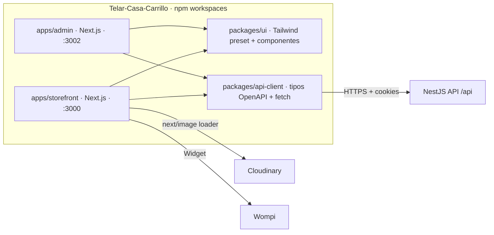

# Plan del frontend — Telar Casa Carrillo

> Estado: **fases 0 a 7 implementadas** (2026-11-06). Brechas B1–B7 cerradas en el backend.
> Backend de referencia: `Telar-Casa-Carrillo-Backend` (NestJS 11, Prisma 6, PostgreSQL, Wompi, Cloudinary).

## Estado

| Fase | Estado | Notas |
|---|---|---|
| 0. Dirección visual | Hecha | «Plaza de Nobsa». `PRODUCT.md`, `DESIGN.md`, prototipo en `prototype/` revisado. |
| 1. Fundaciones | Hecha | Workspaces, `packages/ui` (Tailwind v4), `packages/api-client` (OpenAPI), CSP, CI. |
| B1–B7 (backend) | Hechas | Módulo `content` (banners, testimonios, FAQ, páginas, ajustes, boletín con doble confirmación), contacto, `sort=best_selling`, relacionados, técnicas, perfil y cambio de contraseña, métricas de clientes e inventario bajo. |
| 2. Catálogo | Hecha | Inicio con la pila, catálogo con filtros en la URL, ficha, categorías, artesanos, SEO (metadatos, JSON-LD, sitemap, robots). |
| 3. Cuenta | Hecha | Ingreso, registro, verificación, recuperación, perfil, contraseña, direcciones con municipios DANE, pedidos, privacidad (Ley 1581). |
| 4. Compra | Hecha | Carrito, checkout con cotización del backend, pedido de invitado, pago con Wompi Web Checkout y regreso. |
| 5. Panel | Hecho | Resumen, productos (variantes, fotos, publicación), categorías, artesanos, inventario, pedidos (despachos, factura), pagos y reembolsos, cupones, envíos, clientes, contenido, mensajes, reportes, auditoría, sistema. |
| 6. Contenido | Hecha | Preguntas frecuentes, contacto, páginas legales dinámicas, boletín. |
| 7. Calidad | Hecha en local | Lint, tipos, 19 pruebas unitarias, 14 E2E (escritorio y celular) con axe sin violaciones graves, build de producción de ambas apps. |

### Pendiente (fuera del código o del negocio)

- **Dominio** y despliegue de las tres apps en el mismo sitio (ver README).
- **Llaves de Wompi** (sandbox y producción): sin ellas el pago muestra un error controlado. Probar el regreso `/pedido/:numero/pago?id=`.
- **Contenido real**: fotos, nombres e historia de la familia, textos legales (términos, datos, retracto, garantías, envíos, cambios) revisados por el negocio. Se cargan desde el panel; la tienda no inventa nada mientras faltan.
- SMTP real para los correos (verificación, boletín, pedidos).
- Revalidación inmediata al publicar (hoy el catálogo se refresca cada 60 s por ISR).

## 1. Análisis de requerimientos

El backend ya resuelve la mayor parte de lo que pide el proyecto: catálogo, carrito, inventario con reservas, checkout, pagos con Wompi, envíos, seguimiento, correos, métricas, auditoría y privacidad. El frontend **no calcula nada de negocio**: precios, IVA, descuentos, disponibilidad y totales siempre vienen de la API (`/cart`, `/checkout/quote`).

### Cobertura del backend frente al requerimiento

| Requerimiento | Backend hoy | Frontend |
|---|---|---|
| Catálogo, búsqueda, filtros (categoría, precio, disponibilidad), orden, paginación | `GET /catalog/products` (`q`, `category`, `artisan`, `material`, `minPrice/maxPrice`, `inStock`, `featured`, `sort=newest\|price_asc\|price_desc\|relevance`, `page/pageSize`) | Listo para construir |
| Detalle de producto, variantes, galería, artesano, materiales | `GET /catalog/products/:slug` | Listo |
| Categorías (imagen, descripción, árbol de 3 niveles) | `GET /catalog/categories[/:slug]` | Listo |
| Artesanos (foto, biografía, historia, productos) | `GET /catalog/artisans[/:slug]` | Listo |
| Carrito invitado/usuario | `/cart` (cookie HttpOnly) | Listo |
| Checkout, envío, cupón, documento, pago | `/checkout/quote`, `/checkout/orders`, `/shipping/methods`, `/orders/:n/payments`, `/payments/confirm` | Listo |
| Login, registro, verificación, recuperación | `/auth/*` | Listo |
| Historial y seguimiento | `/account/orders`, `/orders/:n?token=`, `/orders/:n/tracking` | Listo |
| Direcciones, exportar/borrar datos | `/account/addresses`, `/account/data`, `DELETE /account` | Listo |
| Admin: productos, variantes, imágenes, categorías, artesanos, inventario, pedidos, pagos, reembolsos, envíos, cupones, métodos de envío, usuarios/roles, auditoría, métricas, CSV, estado | `/admin/*` | Listo |
| Precio de oferta | `compareAtPrice` por variante | Listo |
| **Banners, testimonios, FAQ, páginas (políticas, historia), newsletter, configuración de la tienda** | Tablas `Banner`, `Testimonial`, `Faq`, `Page`, `NewsletterSubscriber`, `StoreSetting` **sin endpoints** | **Bloqueado** (brecha B1) |
| **Contacto** | No existe | **Bloqueado** (B2) |
| **Productos más vendidos (público)** | Solo en `/admin/metrics` | **Bloqueado** (B3) |
| **Productos relacionados** | No existe | Provisional: misma categoría con `/catalog/products`; ideal B4 |
| **Técnicas** (producto y artesano) | No hay campo ni tabla; solo `Material` | **Bloqueado** (B5) |
| **Editar perfil y cambiar contraseña con sesión** | Solo `GET /auth/me` y recuperación por correo | **Bloqueado** (B6) |
| **Dashboard: clientes registrados, ventas del mes** | Ventas por rango (`from/to`) sí; clientes registrados no | Ventas del mes listo; clientes B7 |

### Brechas que requieren trabajo en el backend

- **B1 — Módulo `content`.** Lectura pública: banners vigentes, testimonios publicados, FAQ, `pages/:slug`, configuración pública (nombre, contacto, redes, textos del footer). Escritura: `POST /newsletter` con consentimiento (Ley 1581) y doble confirmación. Admin: CRUD de todo lo anterior con auditoría y subida de imágenes de banner.
- **B2 — Contacto.** Tabla `ContactMessage`, `POST /contact` con límite de peticiones, aviso a `ADMIN_ALERT_EMAILS` y bandeja en el admin.
- **B3 — Más vendidos.** `sort=best_selling` en `/catalog/products`, calculado sobre pedidos pagados de los últimos N días.
- **B4 — Relacionados.** `GET /catalog/products/:slug/related` (misma categoría o artesano, excluyendo el actual).
- **B5 — Técnicas.** Tabla `Technique` con relación a producto y artesano, igual que `Material`.
- **B6 — Perfil.** `PATCH /account/profile` (nombre, teléfono, documento) y `POST /auth/change-password` (revoca las demás sesiones).
- **B7 — Métricas.** Agregar clientes registrados (total y nuevos en el rango) y la lista de variantes con poco stock (hoy solo el conteo).

Se trabajan en el backend respetando su arquitectura por capas, antes de la fase del frontend que las necesita (ver §7).

## 2. Arquitectura propuesta



### Decisiones

1. **Dos apps Next.js en un mismo repositorio** (npm workspaces). El admin es "independiente" de verdad: otro despliegue, otro dominio, sin código del admin en el bundle público. El backend ya espera esto (`STOREFRONT_URL=:3000`, `ADMIN_URL=:3002`, `CORS_ORIGINS` con ambos).
2. **Dominios del mismo sitio**: `telarcasacarrillo.com` (tienda), `admin.telarcasacarrillo.com`, `api.telarcasacarrillo.com`. Necesario para que las cookies HttpOnly del refresh y del carrito viajen con `SameSite=Lax`. *Nombre de dominio por confirmar.*
3. **Next.js App Router, React Server Components para lo público.**
   - Catálogo, producto, categorías, artesanos, contenido: se renderizan en el servidor con ISR (`revalidate`) → SEO y velocidad.
   - Carrito, checkout, cuenta y todo el admin: componentes cliente que llaman a la API directamente con `credentials: 'include'`, porque la sesión vive en cookies del dominio de la API y en memoria.
4. **Sesión** según el contrato del backend:
   - Access token solo en memoria (nunca `localStorage`); refresh por `POST /auth/refresh` con la cookie HttpOnly al cargar y al recibir 401, con una sola renovación en vuelo.
   - El middleware de Next **no** puede ver la sesión (la cookie es del dominio de la API): las rutas privadas se protegen en el cliente y la autorización real la hace el backend. El admin además oculta menús según los permisos de `/auth/me`.
   - Token de invitado: al abrir `/pedidos/[numero]?token=…` se guarda en memoria, se envía en `X-Order-Token` y se quita de la URL con `history.replaceState`.
5. **Tipos generados, no escritos a mano**: `openapi-typescript` sobre `/api/docs-json` → `packages/api-client/src/schema.d.ts`, cliente con `openapi-fetch`. La CI falla si el esquema generado difiere del versionado.
6. **Estado**: TanStack Query para datos del servidor en el cliente (carrito, cuenta, tablas del admin); sin store global. Estado de UI local con React. Filtros del catálogo en la URL (`searchParams`) para que sean compartibles e indexables.
7. **Formularios**: React Hook Form + Zod. Zod solo valida forma y formato para dar retroalimentación inmediata; la validación válida es la del backend, y sus errores `problem+json` se mapean a los campos.
8. **Errores**: un `ApiError` tipado desde `problem+json`; `error.tsx` y `not-found.tsx` por segmento; toasts para mutaciones; estados de carga con `loading.tsx` y skeletons; estados vacíos diseñados, no texto suelto.
9. **Estilos**: Tailwind CSS v4 con tokens de diseño (`@theme`) definidos en `packages/ui`. Componentes accesibles sobre primitivas sin estilo (Radix) cuando hagan falta (diálogo, menú, select, tabs).

### Reglas de capas en el frontend

Para evitar componentes gigantes y lógica duplicada:

```text
app/ (rutas)  →  features/<dominio>/components  →  features/<dominio>/api (hooks/queries)  →  packages/api-client
                              ↓
                        packages/ui (presentación pura, sin datos)
```

- `app/`: solo composición de página, metadatos y carga de datos del servidor.
- `features/*/api`: única puerta a la API para ese dominio (queries, mutations, claves de caché).
- `features/*/components`: componentes del dominio; reciben datos ya tipados.
- `packages/ui`: botones, inputs, tarjetas, precio, galería, paginación… sin conocer la API.
- ESLint (`no-restricted-imports`) impide que `packages/ui` importe `api-client` y que una feature importe el interior de otra.

## 3. Estructura de carpetas

```text
Telar-Casa-Carrillo/
├── apps/
│   ├── storefront/
│   │   └── src/
│   │       ├── app/
│   │       │   ├── (tienda)/
│   │       │   │   ├── page.tsx                      # Inicio
│   │       │   │   ├── productos/page.tsx            # Catálogo
│   │       │   │   ├── productos/[slug]/page.tsx
│   │       │   │   ├── categorias/page.tsx
│   │       │   │   ├── categorias/[slug]/page.tsx
│   │       │   │   ├── artesanos/page.tsx
│   │       │   │   ├── artesanos/[slug]/page.tsx
│   │       │   │   ├── carrito/page.tsx
│   │       │   │   ├── checkout/page.tsx
│   │       │   │   ├── pago/confirmacion/page.tsx    # vuelta de Wompi
│   │       │   │   ├── pedidos/[numero]/page.tsx     # invitado (token)
│   │       │   │   ├── contacto/page.tsx
│   │       │   │   ├── preguntas-frecuentes/page.tsx
│   │       │   │   └── [pagina]/page.tsx             # políticas, nosotros (Page)
│   │       │   ├── cuenta/
│   │       │   │   ├── ingresar/  registro/  verificar-correo/  restablecer-contrasena/
│   │       │   │   ├── perfil/  direcciones/  pedidos/  pedidos/[numero]/  privacidad/
│   │       │   ├── sitemap.ts  robots.ts  layout.tsx  error.tsx  not-found.tsx
│   │       ├── features/
│   │       │   ├── catalog/  cart/  checkout/  account/  orders/  content/  auth/
│   │       └── lib/                                  # session, image loader, seo helpers
│   └── admin/
│       └── src/
│           ├── app/
│           │   ├── ingresar/page.tsx
│           │   └── (panel)/
│           │       ├── page.tsx                      # Dashboard
│           │       ├── productos/  categorias/  artesanos/  inventario/
│           │       ├── pedidos/  pagos/  envios/  cupones/  metodos-envio/
│           │       ├── clientes/  usuarios/  auditoria/  reportes/  sistema/
│           │       └── contenido/ (banners, testimonios, faq, paginas, newsletter, contacto, configuracion)
│           ├── features/                             # mismo patrón que storefront
│           └── lib/
├── packages/
│   ├── api-client/   # schema.d.ts generado, cliente, ApiError, sesión compartida
│   ├── ui/           # tokens, preset Tailwind, componentes base, íconos
│   └── config/       # tsconfig, eslint, prettier, vitest compartidos
├── e2e/              # Playwright contra el backend en Docker
├── docs/
└── package.json      # workspaces
```

Rutas en español porque el público es colombiano y ayudan al SEO local. Los slugs vienen del backend.

## 4. Módulos

### Storefront

| Módulo | Páginas | Endpoints |
|---|---|---|
| `catalog` | Catálogo, producto, categorías, artesanos | `/catalog/*` (+ B3, B4, B5) |
| `content` | Inicio (banner, historia, testimonios, newsletter), FAQ, contacto, políticas, footer | B1, B2 |
| `cart` | Mini-carrito, página de carrito | `/cart` |
| `checkout` | Datos, dirección (selector DANE), envío, cupón, resumen, pago Wompi, confirmación | `/checkout/*`, `/shipping/methods`, `/orders/:n/payments*` |
| `auth` | Ingresar, registro (con aceptación de términos y datos), verificar correo, restablecer | `/auth/*` |
| `account` | Perfil, direcciones, privacidad (exportar/borrar) | `/account/*`, B6 |
| `orders` | Historial, detalle, seguimiento (cuenta e invitado) | `/account/orders`, `/orders/:n`, `/orders/:n/tracking` |

### Admin

| Módulo | Pantallas | Endpoints |
|---|---|---|
| `dashboard` | Indicadores, ventas por día, más vendidos, pendientes | `/admin/metrics` (+ B7), `/admin/system/status` |
| `catalog` | Productos (estado, variantes, precio y oferta, imágenes, destacado), categorías y subcategorías, artesanos | `/admin/products`, `/admin/categories`, `/admin/artisans` |
| `inventory` | Existencias, entradas, conteos, movimientos, umbral | `/admin/inventory` |
| `orders` | Lista con filtros, detalle, cambio de estado, factura, despachos y eventos | `/admin/orders`, `/admin/.../shipments` |
| `payments` | Pagos, revisión (`needsReview`), reembolsos | `/admin/payments`, `/admin/refunds` |
| `promotions` | Cupones | `/admin/coupons` |
| `shipping` | Métodos de envío | `/admin/shipping-methods` |
| `customers` | Clientes, suspender, roles | `/admin/users`, `/admin/roles` |
| `content` | Banners, testimonios, FAQ, páginas, newsletter, mensajes de contacto, configuración | B1, B2 |
| `reports` | Descarga de CSV | `/admin/reports/*.csv` |
| `audit` | Registro de cambios | `/admin/audit-logs` |

Componentes de admin compartidos: `DataTable` (paginación y filtros por URL), `ResourceForm`, `ImageUploader`, `StatusBadge`, `ConfirmDialog`, `MoneyInput` (COP). Cada CRUD reutiliza estas piezas.

## 5. Relaciones frontend ↔ backend ↔ base de datos

- El frontend **solo** habla con la API REST; nunca con PostgreSQL ni Prisma.
- Los tipos de la API son la única fuente de verdad del contrato (generados de OpenAPI).
- Imágenes: el admin las sube a la API (`multipart`), la API las guarda en Cloudinary y devuelve la URL; el storefront las sirve con `next/image` y un loader de Cloudinary (formato y tamaño automáticos).
- Pagos: el navegador nunca confirma un pago; tras volver de Wompi la página llama a `/payments/confirm` y muestra el estado que responde el backend.
- Revalidación de lo público: ISR por tiempo al inicio; más adelante, un webhook del backend a `/api/revalidate` (con secreto) cuando se publique un producto o contenido.

## 6. Dependencias externas

| Dependencia | Uso |
|---|---|
| next, react, react-dom, typescript | Base |
| tailwindcss v4 | Estilos y tokens |
| @radix-ui/* (selectivo) | Primitivas accesibles |
| @tanstack/react-query | Datos del servidor en el cliente |
| react-hook-form, zod | Formularios |
| openapi-typescript, openapi-fetch | Contrato con la API |
| Widget de Wompi (script externo) | Pago |
| next/font (Google Fonts autoalojadas) | Tipografía |
| vitest, @testing-library/react, msw | Pruebas unitarias y de integración |
| @playwright/test, @axe-core/playwright | E2E y accesibilidad |
| eslint, prettier | Calidad |

Sin librería de componentes completa (MUI, etc.) para no caer en la estética de plantilla.

## 7. Plan por fases

Cada fase termina con su "definición de terminado" (§8). **B#** indica trabajo previo en el backend.

**Fase 0 — Decisiones y dirección visual**
- Confirmar dominios, nombre y pendientes de negocio que afectan la UI (textos legales, retracto, políticas).
- Brief de marca: paleta de materiales naturales (fique, lana cruda, barro, tinte natural), tipografía serif editorial + sans legible, fotografía y tono de voz.
- Prototipo de inicio, catálogo y producto (móvil y escritorio) para aprobar antes de construir.

**Fase 1 — Fundaciones**
- Workspaces, TypeScript estricto, ESLint con reglas de capas, Prettier, Vitest, Playwright, CI.
- `packages/ui`: tokens, preset Tailwind, componentes base.
- `packages/api-client`: generación de tipos, cliente, `ApiError`, sesión (memoria + refresh).
- Layouts, `error`/`not-found`/`loading`, cabeceras de seguridad (CSP con Wompi y Cloudinary).

**Fase 2 — Catálogo público** *(sin bloqueos)*
- Catálogo con filtros en la URL, producto, categorías, artesanos.
- SEO: `generateMetadata`, JSON-LD `Product`/`BreadcrumbList`, `sitemap.ts` desde `/catalog/sitemap`, `robots.ts`.
- Relacionados provisionales por categoría.

**Fase 3 — Identidad y cuenta** *(B6 para perfil)*
- Ingresar, registro, verificar correo, restablecer contraseña.
- Perfil, direcciones con selector DANE, privacidad (exportar y borrar datos).

**Fase 4 — Carrito, checkout y pagos** *(sin bloqueos)*
- Carrito y mini-carrito; unión del carrito al iniciar sesión.
- Checkout con `quote`, reserva, creación del pedido, Widget de Wompi y página de confirmación.
- Pedidos: historial, detalle, seguimiento, acceso de invitado con token.

**Fase 5 — Admin núcleo** *(B7 para dos indicadores)*
- Ingreso, layout, guardas por permiso.
- Dashboard, productos, categorías, artesanos, inventario, pedidos, despachos, pagos y reembolsos, cupones, métodos de envío, clientes, auditoría, reportes, estado del sistema.

**Fase 6 — Contenido** *(B1, B2, B3, B5)*
- Inicio completo: banner, destacados, nuevos, categorías, artesanos destacados, historia, más vendidos, testimonios, newsletter, footer desde configuración.
- Contacto, FAQ, páginas legales e historia.
- Admin de contenido y configuración de la tienda; técnicas en producto y artesano.

**Fase 7 — Calidad y salida**
- Auditoría de accesibilidad (WCAG 2.2 AA), rendimiento (LCP < 2,5 s en móvil 4G en producto y catálogo), revisión de seguridad.
- E2E del recorrido completo contra el backend en Docker y sandbox de Wompi.
- Despliegue de ambas apps, dominios, HTTPS, analítica respetuosa con la privacidad.

Orden sugerido para no esperar: las fases 2, 3 (sin perfil) y 4 avanzan mientras se construyen B1–B7 en el backend.

## 8. Definición de terminado (por pantalla o módulo)

- Datos 100 % desde la API; nada de contenido de negocio escrito en el código.
- Tipos generados; sin `any` ni tipos de la API copiados a mano.
- Estados de carga, vacío y error diseñados.
- Responsive verificado en 360 px, 768 px y 1280 px.
- Accesible: teclado, foco visible, etiquetas, contraste AA, sin errores de axe.
- Imágenes con `next/image`, tamaños y `alt` desde la API.
- Pruebas: unitarias de lógica de presentación, integración de componentes con MSW, y E2E del flujo si es crítico (checkout, login, admin de productos).
- Sin lógica de negocio duplicada (precios, IVA, totales, transiciones de estado).
- Revisado en el navegador, no solo compilado.
